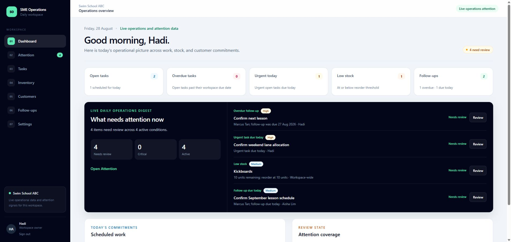

# SME Operations Hub

SME Operations Hub is a portfolio application that demonstrates how a custom internal system can bring a small service business's daily work into one secure workspace. It combines tasks, stock control, customer records, follow-ups, operational attention, and employee access management in a calm owner-facing interface.

> **Portfolio demo:** This is a fictional, login-protected demonstration—not a real customer deployment. The data shown is sample data, and outbound Auth email is routed to Mailtrap Sandbox.

[View the live demo](https://sme-operations-hub-iota.vercel.app)



## Business problem

Small service teams often coordinate work through a mixture of spreadsheets, chat messages, paper notes, and memory. That fragmentation makes it easy to miss a customer promise, lose clarity on task ownership, discover low stock too late, or leave a former employee's access active.

SME Operations Hub puts the operational record and the next action in one place. Its Attention queue derives urgent conditions from the same task, inventory, and follow-up data the team already maintains, so the owner does not need to reconcile separate reports.

## Target user

The primary user is the owner or operations lead of a small service business—for example, a swim school, tuition centre, clinic, maintenance company, studio, or home-services team—with a small employee roster and repeat customer commitments.

The product is intentionally straightforward: it is designed for a team that needs clearer daily operations, not a full enterprise resource planning platform.

## Core features

- **Dashboard:** live summaries of open work, urgent tasks, low stock, follow-ups, and attention coverage.
- **Attention:** a focused, filterable queue derived from overdue tasks, urgent tasks due today, low stock, overdue follow-ups, and follow-ups due today. Acknowledgement is per user and does not hide the unresolved source condition.
- **Tasks:** priority, due date, assignment, status, search, and filters. Owners manage task details; assigned members can update their own task status.
- **Inventory:** item catalogue, reorder thresholds, append-only stock movements, derived balances, movement history, and low-stock signals. Owners maintain items; active members can record movements.
- **Customers:** searchable contact records, notes, follow-up context, and reversible deactivation rather than destructive deletion.
- **Follow-ups:** customer-linked commitments with assignees, due dates, optional times, outcomes, completion history, and overdue/today/upcoming filters.
- **Team lifecycle:** owner-managed employee invitations, resend/cancel handling, display names, deactivation, and reactivation. Deactivation removes open assignments while preserving completed work and audit references.
- **Authentication:** email/password sign-in, password recovery, invitation acceptance, session refresh, and deactivated-account handling.

## Architecture

| Layer | Implementation |
| --- | --- |
| Web application | Next.js 16 App Router, React 19, strict TypeScript, Tailwind CSS 4 |
| Rendering | Server Components for authenticated reads and page composition |
| Mutations | Server Actions with input validation, role checks, and targeted revalidation |
| Authentication | Supabase Auth with SSR cookie handling |
| Data | Supabase PostgreSQL tables, views, functions, triggers, and RLS policies |
| Privileged Auth operations | A server-only Supabase admin client used for invitation delivery and Auth user lookup |
| Hosting | Vercel |
| Demo email | Mailtrap Email Sandbox through Supabase Auth SMTP configuration |

Typical request flow:

1. The Next.js proxy refreshes the Supabase session and protects private routes.
2. A Server Component resolves the authenticated account and active workspace membership.
3. Reads use the user's Supabase session, so PostgreSQL RLS scopes rows to the permitted workspace.
4. A mutation enters through a Server Action, which validates input and application-level permissions before the database applies its own grants, policies, constraints, and triggers.
5. Relevant pages are revalidated so dashboard and attention summaries reflect the new source state.

See [docs/ARCHITECTURE.md](docs/ARCHITECTURE.md) for the interview-ready design walkthrough and Mermaid diagram.

## Security model

Security is layered rather than relying on a hidden menu or a single server check:

- Supabase Auth establishes identity; authorization roles and membership status live in PostgreSQL, not user-editable Auth metadata.
- RLS is enabled on workspace data tables, with workspace and role predicates for authenticated users.
- Owner/member rules are also checked in Server Actions for clear fail-closed behavior and useful responses.
- Database triggers protect invariants such as active assignees, the final active owner, completion metadata, and immutable inventory history.
- Deactivated memberships are checked on requests, so an older browser session does not retain workspace access.
- Session cookies are `HttpOnly` and `SameSite=Lax`, with secure transport required in production.
- Invitation and recovery links use a short-lived, scoped continuation cookie; the token is staged out of the visible URL and verified once by Supabase.
- Sensitive Auth routes send `Referrer-Policy: no-referrer`.
- The Supabase secret key is read only by a `server-only` module, never from a `NEXT_PUBLIC_` variable, and is not used by browser code.
- Public signup and anonymous sign-in are disabled in the demo project.

These controls reduce risk, but they do not replace a client-specific threat model, operational monitoring, or an independent production security review.

## Testing approach

The repository uses complementary checks at different boundaries:

- **Vitest:** 61 tests across 10 files cover filter parsing, attention episode behavior, invitation delivery branches, Auth continuation handling, cookie settings, canonical URL enforcement, formatting, and sanitized error behavior.
- **Transactional SQL regression suites:** seven scripts under `supabase/tests` exercise workspace isolation, owner/member permissions, task and follow-up assignment rules, inventory behavior, Attention RLS, team lifecycle invariants, and production hardening. Fixtures are rolled back and the suites are intended only for an isolated non-production project.
- **Static and production checks:** ESLint, strict TypeScript through the Next.js build, and the production build command.
- **Deployed workflow review:** role-based owner/member journeys, authentication links, deactivation behavior, responsive layouts, and the deployed demo UI.

```bash
npm test
npm run lint
npm run build
git diff --check
```

## Deployment stack

- **Vercel:** hosts the Next.js application and its server execution environment.
- **Supabase:** provides Auth, PostgreSQL, the Data API, database functions, and RLS enforcement.
- **Mailtrap Email Sandbox:** captures demo invitation and password-recovery email; it is not a production delivery channel.
- **Git-based deployment workflow:** application builds are reproducible from `package-lock.json`; deployment configuration and secrets remain outside source control.

## Environment variable names

- `NEXT_PUBLIC_SUPABASE_URL`
- `NEXT_PUBLIC_SUPABASE_PUBLISHABLE_KEY`
- `SUPABASE_SECRET_KEY`
- `APP_BASE_URL`

No credentials, tokens, or populated environment files belong in this repository.

## Local verification

1. Install Node.js 24 LTS and run `npm install`.
2. Create `.env.local` using the variable names listed above.
3. Apply the SQL files in `supabase/migrations` in filename order to an isolated Supabase project.
4. Configure Email/Password Auth, keep public signup and anonymous sign-in disabled, and allow the local `/auth/confirm` callback.
5. Create a fictional owner account, workspace, and matching owner membership.
6. Run `npm run dev` and open `http://localhost:3000`.

## Portfolio and demo limitations

- This is not a real customer deployment and does not contain real operational data.
- Demo access is intentionally login-protected; credentials should be shared privately, never committed or posted publicly.
- Mailtrap Sandbox captures Auth messages rather than delivering production email.
- The Attention digest is generated live in the application. There is no scheduled email digest or cron job.
- There is no public self-sign-up, anonymous access, owner promotion, or ownership-transfer workflow.
- The project demonstrates a configurable workflow foundation, not a finished product for every SME or industry.

## Requirements before a real-client production launch

A client rollout would require discovery and implementation work beyond this portfolio demo:

- Map the client's actual roles, approval rules, terminology, forms, reports, and retention requirements.
- Use separate Supabase and Vercel environments, least-privilege access, managed secret rotation, and verified production domains.
- Replace Mailtrap with a production email provider and configure a verified sending domain, SPF, DKIM, DMARC, suppression handling, and delivery monitoring.
- Define backup, point-in-time recovery, restore testing, incident response, audit retention, uptime, and support procedures.
- Complete a client-specific privacy, legal, security, and data-classification review; add MFA or stronger identity controls where appropriate.
- Add production observability, alerting, rate-limit review, dependency scanning, and capacity/load testing.
- Run user acceptance testing with representative workflows, accessibility checks, browser/device coverage, and staff training.
- Establish data migration, offboarding, account recovery, disaster recovery, ownership continuity, and change-management processes.

## Portfolio documentation

- [Demo script](docs/DEMO_SCRIPT.md)
- [Portfolio case study](docs/PORTFOLIO_CASE_STUDY.md)
- [Architecture](docs/ARCHITECTURE.md)
- [Interview notes](docs/INTERVIEW_NOTES.md)
- [LinkedIn drafts](docs/LINKEDIN_POST.md)

### Recommended screenshot set

| Screen | Why it belongs in the portfolio |
| --- | --- |
| [Dashboard](docs/screenshots/dashboard.png) | Communicates the product's operational overview and visual hierarchy immediately. |
| [Attention](docs/screenshots/attention.png) | Shows the cross-workflow decision queue and the clearest product differentiator. |
| [Inventory](docs/screenshots/inventory.png) | Demonstrates low-stock visibility, role-aware controls, and movement-led stock design. |
| [Follow-ups](docs/screenshots/follow-ups.png) | Connects customer commitments, assignment, due timing, and outcomes. |
| [Team](docs/screenshots/team.png) | Shows employee invitation and access lifecycle controls without exposing the owner email address. |
