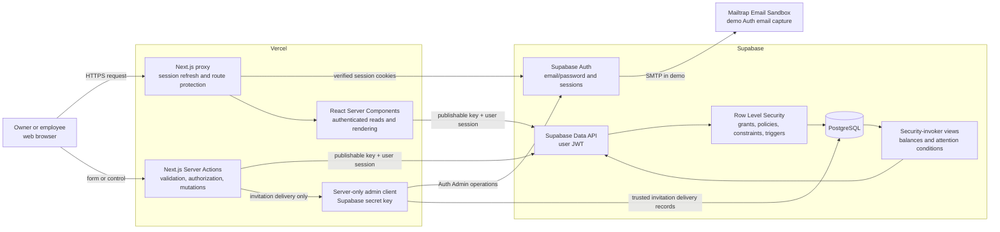

# SME Operations Hub architecture

This document explains the implemented architecture in interview-ready terms. SME Operations Hub is a portfolio demonstration, not a real customer production environment.

## System diagram



## Responsibilities by layer

### Next.js and React

The application uses Next.js 16's App Router with React 19, strict TypeScript, and Tailwind CSS 4. Routes live under `src/app`; reusable interactive controls live under `src/components`; business data access and shared domain logic live under `src/lib`.

The App Router provides layouts, metadata, route grouping, Server Components, Server Actions, and the Auth staging route. The shared application layout composes the authenticated workspace shell and navigation around each operational page.

React is used for composition and focused client-side interactions such as forms, filters, dialogs, and pending states. The application avoids turning an entire route into a client-rendered single-page application.

### Server Components

Data-heavy pages are Server Components. On each private route they:

1. resolve the current Supabase identity;
2. load the user's membership and workspace;
3. distinguish configured, unconfigured, and deactivated accounts;
4. read the permitted workspace data through the user's Supabase session; and
5. render HTML on the server.

This keeps credentials and data-fetching logic off the browser bundle, reduces client-side loading orchestration, and makes authorization part of page composition.

### Server Actions

Mutations enter through Server Actions. An action treats form data as untrusted, parses and bounds input, resolves a fresh account context, checks the role or assignment rule, performs the database operation, handles errors generically, and revalidates affected routes.

The action check is useful for a clear user experience, but it is not the only security boundary. The same request still reaches PostgreSQL with the user's session and must pass grants, RLS policies, constraints, and triggers.

Examples:

- Owners create and edit task details; an assigned member may change only their task's status.
- Owners maintain inventory items; active members may append stock movements.
- Owners manage customer records and follow-up details; assigned members may complete or reopen their follow-ups.
- Only an active owner can reach Team management actions.

### Supabase Auth

Supabase Auth provides email/password identity, sessions, password recovery, invitation acceptance, and Auth email generation. `@supabase/ssr` connects the session to `HttpOnly` cookies used by Next.js.

The Next.js proxy refreshes claims and protects private routes. Server-side account resolution checks both the Auth identity and database membership. A valid Auth session alone is insufficient: the membership must exist and be active for workspace access.

Invitation and recovery links use a continuation flow:

1. the browser receives the token hash in the URL fragment;
2. a same-origin POST validates its shape and stores it in a short-lived, `HttpOnly`, path-scoped cookie;
3. the visible fragment is removed;
4. a Server Action verifies the token once with Supabase; and
5. the cookie expires after verification.

Sensitive Auth routes send `Referrer-Policy: no-referrer`. Public signup and anonymous sign-in are disabled in the demo configuration.

### PostgreSQL

PostgreSQL is the operational source of truth. The main tables are:

- `workspaces`
- `workspace_members`
- `workspace_invitations`
- `tasks`
- `inventory_items`
- `inventory_movements`
- `customers`
- `follow_ups`
- `alert_acknowledgements`

Two important read models are implemented as security-invoker views:

- `inventory_item_balances` derives each current quantity from movements.
- `operations_attention_items` derives active overdue, urgent, low-stock, and due-today conditions.

Database functions implement multi-row lifecycle operations such as creating/accepting invitations and deactivating/reactivating members. Constraints and triggers protect rules that should remain true regardless of the caller, including valid statuses and priorities, active assignees, completion metadata, workspace-local timezones, invitation state, and the final active owner.

### Row Level Security

RLS is the database authorization boundary for API-accessible data. Direct table privileges are revoked and then granted narrowly to `authenticated`; policies add workspace, role, membership-status, assignment, and self-access predicates.

The implemented model is:

| Domain | Active owner | Active member |
| --- | --- | --- |
| Workspace and member directory | Read; update workspace profile | Read permitted workspace/member data |
| Tasks | Create, read, edit, delete, change status | Read; change status only when assigned |
| Inventory items | Create, read, edit | Read |
| Inventory movements | Read and append | Read and append |
| Customers | Create, read, edit, deactivate/reactivate | Read |
| Follow-ups | Create, read, edit, complete/reopen | Read; complete/reopen only when assigned |
| Attention acknowledgements | Read/write own acknowledgement state | Read/write own acknowledgement state |
| Team lifecycle | Invite, cancel, rename, deactivate/reactivate members | No management access |

Deactivated users can read only the membership state needed for the application to present the access-deactivated screen; they cannot continue reading workspace data.

### Server-only admin client

Some invitation operations require Supabase Auth Admin capabilities that a normal user session does not have. A separate client is defined in a module marked `server-only`. It reads `SUPABASE_SECRET_KEY`, disables browser-style session persistence/refresh/URL detection, and is never imported into client code.

Its use is deliberately narrow:

- find an Auth user by normalized email;
- send a native invitation for a new or unconfirmed user;
- send a magic link for a confirmed existing user; and
- record sanitized invitation-delivery state through trusted database functions.

The secret client bypasses normal RLS, so the application first creates or authorizes the invitation through the owner's user-scoped path. Keeping the privileged client isolated makes the trust boundary easier to review.

### Vercel

Vercel hosts the Next.js application, executes Server Components, Server Actions, the proxy, and the Auth staging route, and injects deployment environment variables. `APP_BASE_URL` provides the canonical callback origin and must be HTTPS in production.

Vercel does not replace the database security boundary. Supabase still evaluates the user session, grants, RLS policies, constraints, and functions for each data request.

### Mailtrap Sandbox

Mailtrap Email Sandbox is configured as the demo SMTP destination for Supabase Auth email. It lets invitation and password-recovery flows be exercised without sending messages to real customers. The Next.js application does not expose Mailtrap credentials or call Mailtrap directly.

For a real client, Mailtrap would be replaced by a production email provider with a verified domain, SPF/DKIM/DMARC, suppression handling, monitoring, and an agreed retention/privacy policy.

## Two request paths to explain in an interview

### Normal data mutation

```text
Browser control
  → Server Action validates input and resolves current role
  → Supabase request carries the user's session
  → PostgreSQL grant and RLS policy authorize the row operation
  → constraint/trigger protects invariants
  → Next.js revalidates Dashboard, Attention, and the source page
```

### Employee invitation

```text
Owner submits invitation
  → owner-only Server Action
  → user-scoped database function creates the pending invitation
  → server-only delivery layer classifies Auth identity state
  → Supabase Auth sends an invitation or magic link
  → trusted function records only bounded delivery state
  → invitee verifies the Auth link and accepts the matching invitation
```

## Why this architecture

- **Server Components** keep reads close to authorization and reduce browser-side orchestration.
- **Server Actions** provide a small mutation surface without adding a parallel custom API layer.
- **RLS** protects workspace data even if an application route is implemented incorrectly.
- **Constraints and triggers** protect cross-row and lifecycle invariants that UI checks cannot guarantee.
- **Derived views** avoid duplicating inventory balances and attention state.
- **A separate admin client** makes exceptional privilege explicit and auditable.
- **Vercel and Supabase** provide a small operational footprint appropriate for a portfolio build.

## Limits and production considerations

This architecture is credible for a demonstration, but a real-client design still needs requirements discovery, a threat model, privacy and compliance review, monitoring, backups and restore exercises, rate-limit and capacity testing, production SMTP, MFA decisions, incident response, audit-retention policy, accessibility/user acceptance testing, and an ownership-continuity process.
